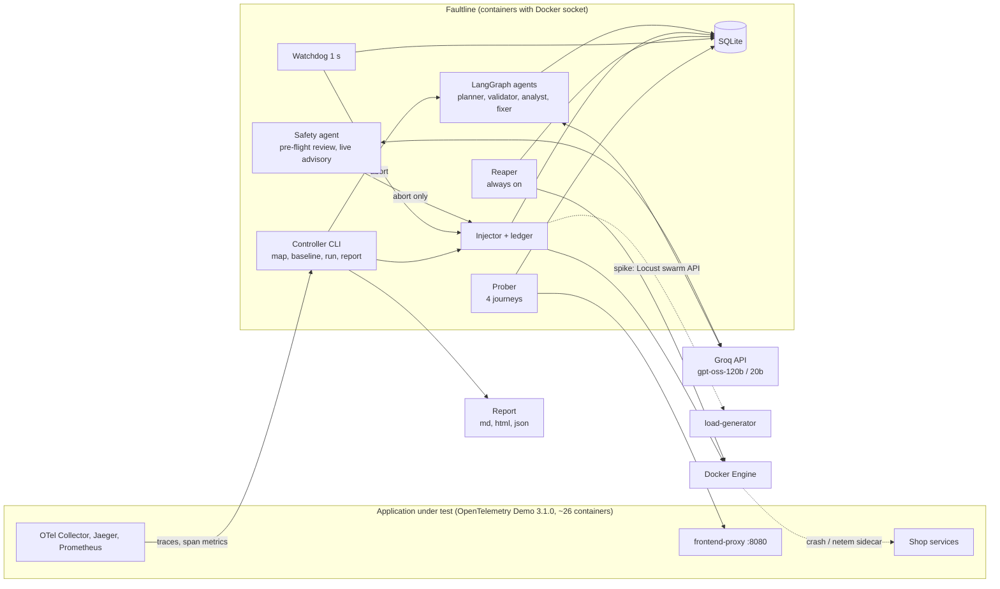
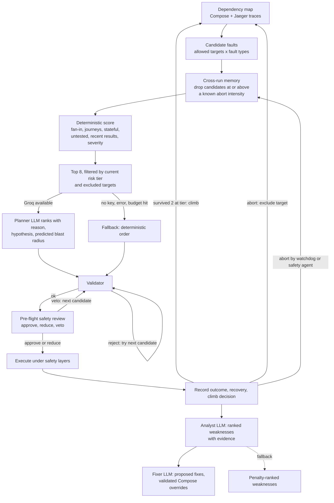
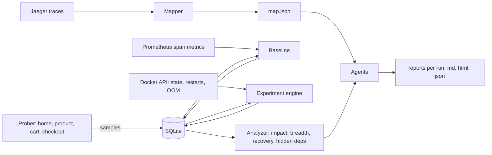

# Architecture

Faultline injects faults into a running microservice application, under independent safety controls, and uses LLM agents to decide what to test and how to interpret the results. This page summarizes how it fits together. The full design is in [OVERVIEW.md](OVERVIEW.md).

## Components

- **Controller** (`faultline` container, started on demand with `docker compose run --rm faultline <command>`) runs every command and holds the Docker socket.
- **Reaper** (`reaper` service) runs continuously in its own container and shares only the SQLite database and the Docker socket with the controller.
- **Traffic spike** is the one fault that is not a container fault. Target `traffic` (the whole shop, never a service) is accepted only for `spike`. The injector reads the load generator's user count from the Locust web API (`GET /stats/requests`), writes it into the ledger revert record before anything changes, then ramps with `POST /swarm`. Revert, kill switch and reaper all post the stored count back, so a failed or expired spike never leaves users above the original value.
- **Application and observability** come unchanged from the pinned upstream Compose files. Faultline reads Jaeger (traces) and Prometheus (span metrics); OpenSearch and Grafana are disabled by a profile.

## How the AI makes decisions

1. **Remember.** Before scoring, candidates are filtered by cross-run memory. From the experiments table (all runs and standalone experiments, last `lookback_days`), the lowest intensity per (target, fault kind) that the watchdog or safety agent aborted is a known limit (a crash counts as maximum intensity; delay uses `delay_ms`, loss uses `loss_pct`, spike uses `users`). Candidates at or above it are excluded and the reason is recorded. Aborts by the operator, preflight, inject or system are ignored. The limits are also given to the planner prompt, so its reasons can cite them.
2. **Score.** Each candidate gets a weighted sum of fan-in, share of journeys whose path includes the target, stateful flag, how untested it is, recent results of neighbours, and fault severity. Weights are in `faultline.toml`.
3. **LLM rank.** The planner model (`openai/gpt-oss-120b`, reasoning effort low) re-ranks the top 8 and gives each a reason. It also states a hypothesis and a predicted blast radius, which the analyst later compares with what was measured (this is how hidden dependencies are detected).
4. **Validate.** The validator applies the same code checks that guard manual runs (allowlist, caps) and rejects the pick if any ledger fault is still active. On rejection the next ranked candidate is tried, up to a configured limit.
5. **Pre-flight review.** After validation and before injection, in both `run` and `experiment`, the safety agent (`openai/gpt-oss-20b`, reasoning effort low, response cache allowed) gets the candidate, tier, hypothesis and predicted blast radius, baseline and thresholds, the learned limits and the last outcomes on the target and its neighbours. It answers approve, reduce or veto. A reduction may only lower `delay_ms`, `loss_pct`, `users` or the duration (a crash can only get a shorter duration, at least 10 s); it is re-validated, and an invalid or raising reduction becomes a veto. A veto skips the experiment and the run takes the next ranked candidate; it counts as a planner attempt, not as an abort, and does not exclude the target. If the review fails, times out or has no key, it approves (recorded as a fallback) and the validator and watchdog still apply. The decision, reason and original versus final parameters are stored with the experiment and the run round.
6. **Risk ladder.** A run starts at tier 1 and climbs one tier after 2 survived experiments. Tier 1: delays up to 50 ms, crashes of services no journey needs. Tier 2: 300 ms delay, 10 % loss, traffic spikes (`spike_tier`), partial-impact crashes. Tier 3: crashes of critical or stateful services, including flagd. An aborted experiment excludes its target for the rest of the run.
7. **Analyze and fix.** The analyst ranks weaknesses using measured impact, breadth and recovery; the fixer proposes a fix for each. Proposed Compose overrides are checked (only restart, healthcheck and deploy keys are accepted). Generating the report never applies anything.
8. **Verify a fix.** `faultline fix` applies the restart-policy and raised memory or CPU limit part of a config fix to one running, allowlisted container through the Docker API (no `docker compose`), after writing the original HostConfig values to the `fixes` table. It waits for the container to be stable, re-runs the same experiments through the normal guarded path, compares mean penalty before and after (IMPROVED, NO CHANGE, WORSE, or INCONCLUSIVE) and keeps the fix only on IMPROVED, otherwise restoring the originals. Fixes are not fault-ledger entries: the reaper and the kill switch never revert them, `fix --revert-all` does. Healthcheck, replica, code and architecture changes remain proposals.
9. **Fallback path.** Every agent has a deterministic fallback used when there is no key, the call fails or times out, the response does not parse, or the daily budget is spent. The run result records whether each step used the LLM or the fallback.

Budget control: a shared request limiter, a per-model token bucket (8000 tokens/min), a per-model daily budget (180,000 tokens), and a 6 h response cache. `agents usage` and `agents trace` expose all of it.

**Resilience score.** Per experiment, penalty = 100 x (0.5 x impact + 0.3 x breadth + 0.2 x recovery). A service scores 100 minus its worst penalty. The overall score is the mean of service scores weighted by the number of journeys the service sits on. Weights and caps are in `[score]`. A recovery that was not measured (operator stop) contributes 0 and is noted in the report; the analyst drops recovery weaknesses whose recoveries are at or below `recovery_floor_s`.

## Safety controls

Layers are independent: a failure of one (including the LLM) does not remove the others.

| Layer | Covers | How it was tested |
|---|---|---|
| Preflight | Starting a fault on an already degraded system | Part of every experiment start; see `faultline.toml` [preflight] |
| Allowlist and caps | Wrong targets, oversized faults | Unit tests (`tests/test_faults.py`) |
| Write-ahead ledger | Controller dies after or during apply | Unit tests (`tests/test_ledger.py`); used by the kill switch and reaper |
| Watchdog (1 s) | Journey error rate or p95 beyond baseline-derived thresholds; loss of observability (no samples for 5 s) | Live: cart crash aborted at p95 3007 ms |
| Pre-flight safety review | An experiment that looks likely to breach limits or repeat a known abort, before anything is injected | Can only approve, lower intensity or veto; a failed review approves and the layers below still apply |
| Safety agent (live) | Harm outside the predicted blast radius or a worsening trend, checked about every 10 s | Advisory only; can abort, cannot continue past a watchdog abort; slow or failed checks are ignored |
| Kill switch | Operator wants everything undone now | Live: `faultline stop` plus STOP sentinel |
| Reaper | Controller crash or hang; expired faults | Live: reverted stale-heartbeat faults (measured 13 s) |
| Self-expiring netem sidecar | Controller and reaper both dead | Live: rule removed at TTL with both stopped |
| Combined-failure rules | A declared combo of two faults: allowed pairs, one crash at most, distinct targets, limits x0.8, all parts in the ledger before any apply, revert of earlier parts if a later one fails | Unit tests (`tests/test_combo.py`); live: spike + delay, refusal, kill switch |

## Data flow

SQLite (a Docker volume) holds probe samples, baselines, the ledger, the controller heartbeat, experiments, runs and rounds, agent traces, LLM usage and the LLM response cache. The map is written to `map.json` beside it. Reports are written to `./reports`.

## Key design decisions

| Decision | Reason |
|---|---|
| Docker Compose, not Kubernetes | One command on Windows, macOS, Linux and Codespaces with no cluster to install; the demo ships Compose files |
| Controller runs in a container with the Docker socket | Nothing to install on the host; identical behaviour on every platform |
| Deterministic watchdog as the hard floor under the LLM safety agent | Safety must not depend on model availability or judgement; the agent can only make aborts earlier |
| Write-ahead ledger plus separate reaper plus self-expiring sidecar | Faults get reverted even if the controller and reaper both die |
| LLM ranks and explains; code scores, validates and bounds | Unsafe or malformed model output cannot reach the injector |
| Groq free tier with a token limiter, daily budget and cache | The tool must run on a free key, and still run (deterministically) without one |
| Pinned upstream app via git submodule, tweaks in `compose.override.yaml` | Reproducible results; no edits under `vendor/` |
| Thresholds derived from a measured baseline, with floors | Avoids tripping on normal noise and avoids a limit too loose to protect anything |
| A combo is one experiment with one ledger entry per part | Reuses the single-experiment watchdog, review, kill switch, reaper and `revert_experiment` unchanged; the report and memory score it as a unit, never as separate single faults |
| Fixes are proposed; only restart-policy and raised memory or CPU limit fixes can be applied, by an explicit command | A human confirms the change, only reversible Docker API updates are used, and the result is verified by re-running the same experiment |
| Fixes live in their own table, not in the fault ledger | A fix is meant to persist after the experiment: the reaper and kill switch must not undo it, and an open ledger entry would block every experiment |
